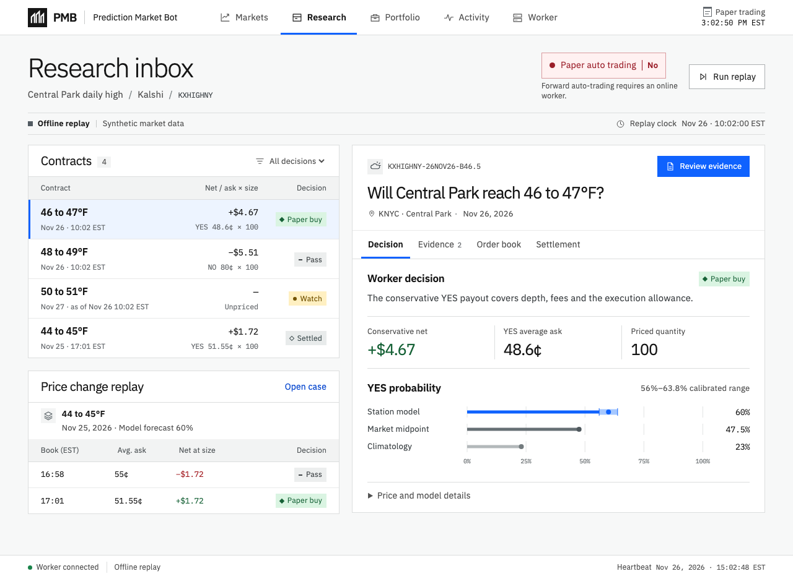

# Prediction Market Bot

Prediction Market Bot is a desktop app that practices trading Kalshi’s daily high temperature markets for New York’s Central Park (`KXHIGHNY`). It starts with **$10,000 in paper funds**, watches the public market and records what it would have bought, the price it could have paid and how the position settles. You can follow it on macOS, Windows or in a browser connected to your own worker. Getting started requires no exchange login, model subscription or API key.

**Get the app.** Download the universal Mac ZIP or the Windows x64 Setup executable. The Mac build has an ad hoc signature and lacks Apple notarization. The Windows installer is unsigned and can prompt to install Microsoft Edge WebView2. Checksums accompany the downloads. [Releases](https://github.com/Jwarren-ENG/prediction-market-bot/releases) · [Microsoft WebView2 distribution](https://learn.microsoft.com/en-us/microsoft-edge/webview2/concepts/distribution)

| If you want to… | Start here |
| --- | --- |
| Install the app, run from source, keep it running after login, back up or troubleshoot | [Setup and operating guide](docs/SETUP.md) |
| Understand where prices come from, why the worker passes on a contract, and how it calculates risk and returns | [How the system works](docs/HOW_IT_WORKS.md) |
| Inspect desktop build and test results | [Native checks on GitHub Actions](https://github.com/Jwarren-ENG/prediction-market-bot/actions/workflows/native.yml) |



## First session

1. Open **Prediction Market Bot**. The Mac release is a universal app. On Windows x64, run the per-user setup executable, then open Prediction Market Bot from Start. The Windows installer checks for Microsoft Edge WebView2 and offers the bundled Microsoft bootstrapper when required.
2. In **Research**, select **Open case** in *Price change replay*. Switch between Decision, Evidence, Order book and Settlement. The replay holds the modeled probability constant while repricing the order against two different books. All replay evidence, capital, fills and returns are synthetic.
3. Open **Portfolio** to see the starting balance, current account value and gain or loss after fees, including changes in the value of open positions. A partially filled order counts once. A filled order counts as settled when its payout has posted. **Activity** records decisions, fills and settlements.
4. For current data, open **Worker**, select **Forward paper**, and inspect *Recent public weather reports*. The worker collects public NOAA observations and forecasts every five minutes, including while the app is closed. In **Worker → Paper automation**, authorize private Kalshi capture if your applicable terms permit it. The first contracts normally say **Watch**. Each forecast needs at least 30 comparable, previously resolved station days matched by source version, lead time and season. Replay fixtures never count toward this threshold.
5. In **Markets** or **Research**, **Paper auto trading** shows whether new forward paper orders are enabled. **Yes** pulses blue. **No** stays red. Switch it off to pause entries while quotes and settlements continue. **Run scan** spins during collection and displays the result when the worker records it. A risk halt has its own reason and recheck control in **Worker**.
6. Visit **Activity** to compare the last successful quote response with actual price moves. In **Markets**, select the same contract and switch between **15 min**, **1 hour** and **4 hours** to see its observed bid and ask ranges. The corner clock and timestamps default to New York time. Change the display time zone in **Worker**.

**Markets** shows the public Kalshi bid and ask for each open Central Park contract. With market capture enabled, the worker checks prices approximately every 15 seconds, including while the window is closed. The default chart opens on the last four hours, including the period before the worker started. Kalshi supplies completed one-minute bid and ask closes. The worker also keeps recent 15-second snapshots. The chart labels each source and leaves gaps where a price is missing. Use the time controls to inspect a shorter window. The five-minute paper strategy still checks forecast evidence, fees and executable order depth before placing a paper order. [Kalshi public market data](https://docs.kalshi.com/getting_started/quick_start_market_data) · [Kalshi market price history](https://docs.kalshi.com/api-reference/market/batch-get-market-candlesticks)

The release contains one strategy and one venue. Polymarket US, brokerage holdings, equity trading, options and funded execution are later milestones. The forward account earns its own trading record. The first review for a possible funded pilot calls for 90 distinct resolved dates, including at least 30 observed prospectively. Review the results after fees, compare forecast accuracy with the market, examine losing periods, and retest with worse fill prices. A funded pilot requires a separate owner decision and a new account connector. Kalshi provides a production key ID and a private signing key for that connection. The key belongs on the owner's device. [Kalshi authenticated account access](https://docs.kalshi.com/getting_started/quick_start_authenticated_requests)

## Research providers

The local analyst works as soon as the app opens. To add Gemini, Perplexity or an OpenAI-compatible OmniRoute gateway, open **Worker → Research analysts**. Select a provider, enter a model ID available to your API account, set the daily call cap, add its API key where required, enable it, then choose **Save analyst settings**. Run a review from a contract’s Evidence tab. When automatic research is enabled, each forward scan reviews another open contract in turn. With the daily external call cap set to zero, the local analyst still writes notes in the contract’s Evidence tab.

Gemini summarizes changes in the evidence. Perplexity checks for contradictions and timestamp gaps. The gateway supplies an independent critique. The worker sends a dated weather packet and stores each analyst’s output separately. The paper decision uses station data and executable depth. Changing a language model cannot increase its order authority.

Keys entered on Mac go in Keychain. Windows uses DPAPI under your Windows account. A service can supply `GEMINI_API_KEY`, `PERPLEXITY_API_KEY` (or `PPLX_API_KEY`), or `OMNIROUTE_API_KEY`. Set `OMNIROUTE_BASE_URL` when binding an environment key to a different gateway. A local gateway defaults to `http://127.0.0.1:20128/v1`. Remote gateways require HTTPS. Paid subscriptions and API quotas depend on the provider and account.

The default daily cap is three external requests across providers. PMB also reserves 25¢ of estimated usage per external attempt and stops at $15 of monthly reservations. Actual prices depend on the model and gateway. Set billing limits with the provider for a hard dollar ceiling. Provider clients were tested with mock responses. Enabling any particular account requires its own credentials, model access and quota. [Gemini generateContent](https://ai.google.dev/api/generate-content) · [Perplexity Agent API](https://docs.perplexity.ai/docs/agent-api/quickstart) · [OmniRoute](https://github.com/cheaper-inference/OmniRoute)

## Keeping the worker running

Closing a desktop window leaves its worker running. For automatic restarts after login on macOS, copy the app to a permanent location first. From Terminal, use the installed helper to enable, inspect or remove the login supervisor.

```sh
worker="$HOME/Applications/Prediction Market Bot.app/Contents/MacOS/pmb-worker"
"$worker" background install
"$worker" background status
# Stop and remove this user's login supervisor
"$worker" background remove
```

On Windows, run these from PowerShell for the default installation. Replace `install` with `status` or `remove` as needed. The scheduled task is scoped to the current user and starts at login.

```powershell
$app = Join-Path $env:LOCALAPPDATA 'Programs/Prediction Market Bot/payload'
& "$app/runtime/python.exe" -I -B "$app/background.py" install
```

A desktop that is asleep, powered off or signed out cannot deliver continuous coverage. For round-the-clock operation, run the same worker on one always-on private host you control. Python 3.12+ and this repository are sufficient for the worker. On Linux, a user service can use the following example. Replace both paths with absolute paths on your host. Enable it with `systemctl --user enable --now pmb.service`. The user's service manager must survive logout for continuous coverage. Keep one authoritative data directory and run a second desktop as a client.

```ini
[Unit]
Description=Prediction Market Bot paper worker
After=network-online.target

[Service]
Type=simple
WorkingDirectory=/absolute/path/to/project
ExecStart=/usr/bin/python3 -I -B /absolute/path/to/project/pmb.py serve
Restart=on-failure
RestartSec=15
UMask=0077

[Install]
WantedBy=default.target
```

The worker listens on loopback, normally port 47823. From a second machine, create a private SSH tunnel, for example `ssh -N -L 47824:127.0.0.1:47823 owner@worker-host`. On the host, run `python3 -I -B pmb.py connect` in a private terminal. Paste its private link into **Worker → Connect to another worker**, changing only the local port from 47823 to 47824 for that tunnel. The fragment grants control of this paper worker. Keep the connection link out of tickets, emails, screenshots and shared logs. The native app starts with its own local worker on a fresh launch. Both clients see the same state after opening the same remote connection.

## Optional email

Run `pmb-worker mail-preview` on Mac or `python pmb.py mail-preview` from source to read the generic digest locally. The worker can send a daily forward digest plus degradation and recovery notices to one owner address. A new local calendar day uses New York time. An unresolved paper order, risk stop or unavailable feed can trigger review. A worker that has stopped cannot send its own outage email. Independent host monitoring is a separate deployment step.

To opt in, configure the worker process environment with `PMB_MAIL_ENABLED=1`, `PMB_MAIL_TO`, `PMB_MAIL_FROM`, `PMB_SMTP_HOST`, `PMB_SMTP_USER` and `PMB_SMTP_PASSWORD`. For a service, supply these through your private service environment. TLS is required. `PMB_SMTP_SECURITY=ssl` defaults to port 465. `starttls` defaults to 587. `PMB_SMTP_PORT` overrides the port. Keep SMTP secrets out of shared scripts and shell history. Worker shows the delivery status. An ambiguous SMTP acknowledgement stays available for review to avoid mailing the same notice twice.

## How a decision works

The collector archives source, publication, first availability and retrieval times. It checks the contract’s current station, bin and settlement terms, records each side of the executable book, and keeps weather observations separate from the venue's final result. Model calibration compares prior forecast errors at comparable horizons and seasons. A confidence bound, venue taker fees, visible size and a 1¢ per-contract execution allowance all enter the decision. A 120-second quote age ceiling, a missing fee schedule, ambiguous settlement terms or inadequate calibration can keep an entry on Watch. At most 100 contracts enter at a time.

The test mandate caps each new position at $100, each event at $200 and total open event risk at $500. A $150 daily marked loss or $400 peak drawdown pauses entries. The ledger models partial fills and unknown acknowledgements, reserves outstanding cash, marks thin books conservatively and deduplicates settlements. A real forward position settles only from a compatible final venue result. Exceptional outcomes stay pending for review. Use the scorecard to compare station probabilities, market midpoints and climatology on matched event dates. A single synthetic outcome demonstrates the calculation only. [Kalshi market data](https://docs.kalshi.com/getting_started/quick_start_market_data) · [Contract terms](https://assets.kalshi.com/contract_terms/GLOBALTEMPERATURE.pdf) · [Fee schedule](https://kalshi.com/fee-schedule) · [National Weather Service API](https://www.weather.gov/documentation/services-web-api)

## Local data and recovery

On macOS, private data lives in `~/Library/Application Support/Prediction Market Bot`. Windows uses `%LOCALAPPDATA%\Prediction Market Bot`. Linux uses `$XDG_DATA_HOME/prediction-market-bot` or its standard home-directory fallback. `PMB_DATA_DIR` selects a different directory. `replay.sqlite` and `forward.sqlite` are independent accounts. `worker.sqlite` holds settings, research notes and the email outbox. The `feeds` directory retains source evidence. One process owns each data directory.

For a consistent file-level backup, stop the supervisor, stop the worker, then copy the complete data directory to private encrypted storage. Restore to a directory readable by the owner and start a single worker against it. Preserve the original directory until you have verified the restored positions, fees and activity. Treat the connection key as a secret. Re-enter provider credentials if moving to a different OS account.

## Run from source

```sh
python3 -B -m unittest discover -s tests -v
node --test tests/test_markets_ui.cjs tests/test_desk_ui.cjs
python3 -I -B pmb.py replay-check
python3 -I -B pmb.py serve
```

Use a second private terminal for `python3 -I -B pmb.py connect` and open the returned link in a browser. For an isolated, network-free session, use `python3 -I -B pmb.py --data-dir /path/to/temporary/data serve --offline --port 47824`. A headless host can run the same public-data and paper-account features without a desktop shell. `pmb.py stop` asks its local worker to quit.

The desktop shell is Rust/Tauri 2. Build with `cargo build --manifest-path desktop/Cargo.toml --locked --release`. The packaged shell serves the shared HTML, CSS and JavaScript from its authenticated local worker. The interface uses bundled IBM Plex fonts. `scripts/fetch_runtime.py` obtains checksum-pinned platform Python builds. `scripts/package.py --help` lists packaging inputs, including a second macOS architecture and the Microsoft WebView2 bootstrapper. The native workflow in `.github/workflows/native.yml` builds, installs and opens a platform package. Its presence is independent of whether a particular run has been executed.
